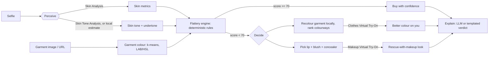

# Flattr: the skin-aware outfit check

[](https://github.com/OWNER/REPO/actions/workflows/ci.yml)
[](LICENSE)

> **Will this make me look tired? Check before you buy.**

People buy clothes online that look great on the model, then look washed out in them. Garment colour reflects onto the face and can amplify what your skin is doing *today* (dark circles, redness, dullness). Personal-colour apps give a static palette from one photo; try-on tools show fit, not whether the colour flatters you. Flattr connects **skin condition + skin tone + the specific garment** before checkout, then offers a one-tap fix: a better colour shown on you, or the makeup that rebalances the shirt you love.

> Flattr is a styling aid, **not a medical device**. See [Disclaimer](#disclaimer-and-limitations).

## How it works



The Stylist Agent (`lib/agent.ts`) streams each step to the UI over SSE as a live timeline. More detail: [docs/ARCHITECTURE.md](docs/ARCHITECTURE.md).

## YouCam APIs used

| API | Endpoint (`/s2s/v2.0/...`) | Purpose |
|---|---|---|
| AI Skin Analysis | `task/skin-analysis` | Dark circles, redness, oiliness, texture, spots, moisture, radiance scores |
| AI Clothes Virtual Try-On | `task/cloth-v4` | The original and the recoloured garment on you |
| AI Makeup Virtual Try-On | `task/makeup-vto` | Lip, blush and concealer on the try-on image |
| AI Skin Tone Analysis | `task/skin-tone-analysis` | Used **when your key is entitled to it**. Otherwise a local YCbCr skin-pixel median estimate (`lib/tone-local.ts`) is used and labelled "local estimate" |

## The Flattery engine

Deterministic colour-theory rules, not an API wrapper: sallow reflection, redness echo, wash-out and undertone clash, each with a penalty, plus small bonuses. Output is a 0-100 score and the top two reasons in plain English. Wording is risk-based ("can", "tends to"); no precise optical claims. Full rules and how to extend them: [docs/SCORING.md](docs/SCORING.md).

## Quick start

Requires Node.js 20+.

```bash
npm install
cp .env.example .env     # add YOUCAM_API_KEY (or leave empty for cached demo mode)
npm run dev              # http://localhost:3000
```

## Configuration

| Variable | Purpose |
|---|---|
| `YOUCAM_API_KEY` | YouCam API Bearer token used for every API (shared). Never commit it |
| `YOUCAM_KEY_SKIN` / `_TONE` / `_CLOTHES` / `_MAKEUP` | Optional per-API keys; each overrides `YOUCAM_API_KEY` for that API |
| `YOUCAM_API_BASE` | API host (default `https://yce-api-01.makeupar.com`); set a regional host if your console shows one |
| `DEMO_MODE=1` | Serve only cached results (blocks live calls when no YouCam key is set) |
| `ANTHROPIC_API_KEY` | Optional; enables an LLM-written verdict. The app works without it |
| `FLATTR_CACHE_DIR` | Where cached results live (default `./cache`). See [docs/CACHE.md](docs/CACHE.md) |

## Scripts

| Command | What it does |
|---|---|
| `npm run dev` | Dev server on port 3000 |
| `npm run build` / `npm start` | Production build and server |
| `npm run lint` | ESLint |
| `npx tsx scripts/score-check.ts` | Sanity check of the Flattery scoring expectations |
| `node scripts/make-samples.mjs` | Generate sample images |

## Project layout

```
app/                 Next.js App Router (UI + app/api/analyze/route.ts SSE endpoint)
lib/agent.ts         Stylist Agent: orchestrates steps, emits events
lib/flattery.ts      Scoring rules, colourway ranking, makeup rescue
lib/youcam.ts        YouCam client (upload -> task -> poll) + disk cache
lib/tone-local.ts    Local skin-tone estimate fallback
lib/color.ts         Colour maths, dominant colour, garment recolouring
docs/                Architecture, scoring, API, cache, hackathon history
scripts/             Dev utilities
public/samples/      Sample selfies and garments
```

## Documentation

[Architecture](docs/ARCHITECTURE.md) | [Scoring](docs/SCORING.md) | [API](docs/API.md) | [Cache](docs/CACHE.md) | [Deploy](DEPLOY.md) | [Changelog](CHANGELOG.md)

## Screenshots

TODO: capture real screenshots as described in [`screenshots/README.md`](screenshots/README.md).

## Privacy

- Your selfie and garment image are sent to the YouCam (Perfect Corp) APIs for analysis and try-on, and, if configured, a text summary (scores and reasons, not images) to Anthropic for the verdict.
- Flattr stores nothing server-side except the result cache, keyed by a hash of the input image bytes. Cached files can include skin metrics and generated try-on images; delete the cache directory to remove them.
- Garment URLs are fetched server-side.
- Review the YouCam and Anthropic privacy terms before deploying publicly.

## Disclaimer and limitations

- **Not a medical device.** Skin metrics are cosmetic estimates, not diagnoses or medical advice.
- The skin score direction assumption (higher `ui_score` = healthier) is **unverified** against real API responses; see [docs/SCORING.md](docs/SCORING.md).
- Colour estimates (garment and skin) depend on lighting, white balance, camera and photo compression. The local tone estimate is rough.
- Rules are heuristics from colour theory, not a validated model of how every face looks in every colour.

## Roadmap

- Browser extension: score the garment on any retailer page
- Retailer widget: embeddable "will this flatter me" check
- B2B API for retailers and styling apps
- Verify skin-metric semantics against real responses; add automated tests

## Contributing

See [CONTRIBUTING.md](CONTRIBUTING.md), [CODE_OF_CONDUCT.md](CODE_OF_CONDUCT.md) and [SECURITY.md](SECURITY.md).

## License

[MIT](LICENSE)
