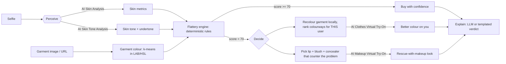

# Flattr: the skin-aware outfit check

> **Will this make me look tired? Check before you buy.**

People buy clothes online that look great on the model, then look washed out in them. Garment colour reflects onto the face and amplifies what your skin is doing *today* (dark circles, redness, dullness). Personal-colour apps give a static palette from one photo; try-on tools show fit, not whether the colour flatters you. Flattr connects **live skin condition + skin tone + the specific garment** before checkout, then offers a one-tap fix: a better colour shown on you, or the exact makeup that rescues the shirt you love.

## How it works



The **Stylist Agent** (`lib/agent.ts`) streams each step to the UI over SSE as a live timeline, naming the YouCam API behind each step.

## YouCam APIs used

| API | Endpoint (`/s2s/v2.0/…`) | Why |
|---|---|---|
| AI Skin Analysis | `task/skin-analysis` | Dark circles, redness, oiliness, texture, spots, moisture, radiance scores for *today* |
| AI Skin Tone Analysis | `task/skin-tone-analysis` | Skin colour (→ undertone), eye/lip/hair colours |
| AI Clothes Virtual Try-On | `task/cloth-v4` | Shows the original and the recoloured garment on you |
| AI Makeup Virtual Try-On | `task/makeup-vto` | Applies lip, blush and concealer on the try-on image |

All use the File API (`file`) → PUT pre-signed URL → create task → poll flow. Responses are cached to `cache/` keyed by image hash, so repeat runs cost zero units.

## The Flattery engine (`lib/flattery.ts`)

Deterministic colour-theory rules, not an API wrapper. Inputs: garment colour (LAB/HSL), skin tone + undertone, skin concern severities.

| Rule | Trigger | Linked metric |
|---|---|---|
| Sallow reflection | Yellow-green / olive / mustard garment | Dark circles |
| Redness echo | Saturated red / coral / pink | Redness |
| Wash-out | Garment lightness and chroma close to skin | Radiance / dullness |
| Undertone clash | Warm skin + icy pastels, cool skin + earthy warm tones | Undertone |

Output is a 0–100 score and the top two reasons in plain English. Wording is deliberately risk-based ("can make", "tends to"); we never claim precise optical percentages.

## Setup

```bash
npm install
cp .env.example .env     # add YOUCAM_API_KEY
npm run dev              # http://localhost:3000
```

| Variable | Purpose |
|---|---|
| `YOUCAM_API_KEY` | YouCam API Bearer token used for every API (never commit) |
| `YOUCAM_KEY_SKIN` / `_TONE` / `_CLOTHES` / `_MAKEUP` | Optional per-API keys; each overrides `YOUCAM_API_KEY` for that API |
| `YOUCAM_API_BASE` | API host; set your India-region host if your console shows one |
| `DEMO_MODE=1` | Serve committed cached results for the samples without a key |
| `ANTHROPIC_API_KEY` | Optional; LLM-written verdict. App works without it |

To refresh the demo cache: set a key, unset `DEMO_MODE`, run each sample once, and commit `cache/`.

## Screenshots

See [`screenshots/`](screenshots/).

## License

MIT
