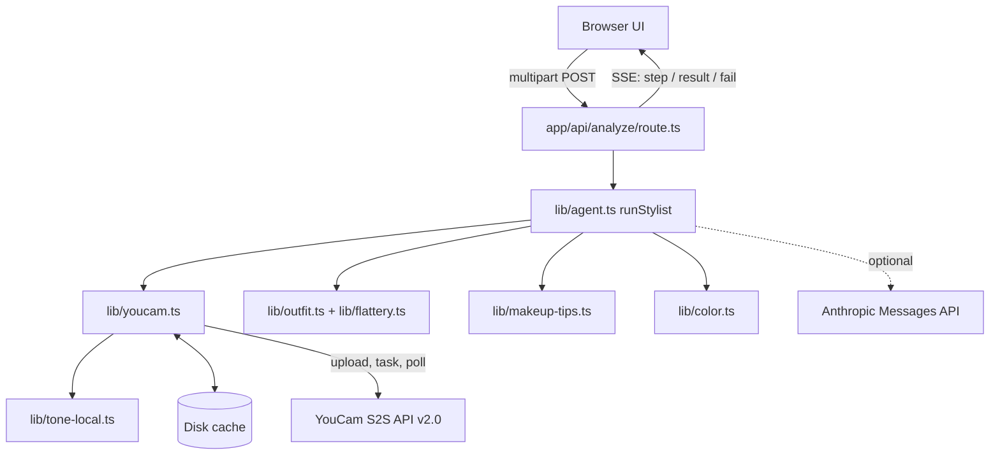
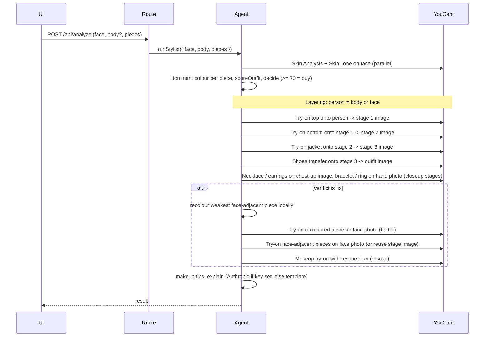

# Architecture

Flattr is a Next.js 15 (App Router, TypeScript) app. A single API route runs a multi-piece "Stylist Agent" that streams progress to the browser over Server-Sent Events.

## Components

| Module | Responsibility |
|---|---|
| `app/api/analyze/route.ts` | Parses the form (face, body, hand, per-role pieces for all eight roles), validates `ROLE_REQUIRES`, loads images (upload, URL or sample), runs the agent, emits SSE |
| `lib/agent.ts` | Orchestrates the steps and layered try-on; each external call is isolated so partial failures degrade gracefully |
| `lib/youcam.ts` | Typed client: File API upload, create task, poll; key selection; cache |
| `lib/flattery.ts`, `lib/outfit.ts` | Deterministic per-piece scoring rules, outfit score, colourway counterfactuals, rescue makeup plan |
| `lib/makeup-tips.ts` | Actionable makeup tips from the outfit, tone and skin metrics |
| `lib/color.ts` | RGB/LAB/HSL maths, dominant colour (k-means via sharp), garment recolouring |
| `lib/tone-local.ts` | Local skin-tone estimate when Skin Tone Analysis is unavailable |

## Agent sequence

Steps: perceive, garments, score, decide, tryon, recolor, rescue, tips, explain. Skin analysis and tone run on the **face** photo; the clothing chain (top, bottom, jacket) and then shoes run on the **body** photo (full length) when there is one, otherwise clothing runs on the face photo (chest-up only). Jewellery stages are separate close-ups: necklace then earrings on the chest-up image (the plain face photo, or the chest-up try-on image when no body photo exists), bracelet then ring on the **hand** photo. Stages carry `group: "outfit" | "closeup"`.

A failed layering stage records an error and the chain continues from the previous person image. Failures in recolour, rescue or makeup never abort the run; they land in `result.errors`. A failure in perceive, garment colour or scoring aborts with a `fail` event. Bad input (no pieces, bottom/shoes without a body photo, bracelet/ring without a hand photo) throws `InputError`, whose message is shown to the user.

## Cost and units

Each uncached piece costs one try-on call (clothes, shoes or jewellery); the fix path adds a recolour try-on, optional rescue try-ons and one makeup call. `unitsEstimate` sums a constant per live call (`UNITS_PER_CALL` in `lib/agent.ts`) and skips cache hits, which `lib/youcam.ts` reports through an optional `onCall` callback. It is an estimate only. Per the YouCam docs, bottoms need a worn-outfit reference photo and a full-body person photo. `GARMENT_CATEGORY` in `lib/youcam.ts` is the single place to change the category sent per role; its values are unverified until a real run, and the category is part of the try-on cache key.

## Shoes and jewellery endpoints

Defined in one place each (`SHOES_TASK`, `JEWELLERY_TASK` in `lib/youcam.ts`) so a first real run can correct them. Each API has its own key variable (`YOUCAM_KEY_SHOES`, `YOUCAM_KEY_JEWELLERY`) with `YOUCAM_API_KEY` as fallback, and its own cache prefix (`shoes_`, `jewellery_<role>_`).

| Piece | Path under `/s2s/v2.0/task/` | Status |
|---|---|---|
| shoes | `shoes-transfer` | VERIFIED: docs, and live probe (body `{src_file_id, ref_file_id}` accepted, task ran) |
| necklace | `2d-vto/necklace` | VERIFIED: docs; endpoint exists for our key |
| bracelet | `2d-vto/bracelet` | VERIFIED: docs; endpoint exists for our key |
| earrings | `2d-vto/earring` | EXISTS (live probe returns 400, a made-up path 404); docs not found, parameter names assumed |
| ring | `2d-vto/ring` | EXISTS (live probe); docs not found, parameter names assumed |

The jewellery body (`src_file_id`, `ref_file_ids`, `source_info`, `object_infos`) passes required-field validation but is not yet verified end to end with real images. Photo requirements: shoes need a full-body photo with the foot fully visible; necklace needs a front-facing photo with the neck visible; bracelet and ring need the back of the hand with all fingers visible. Jewellery is scored but never recoloured.

## Skin tone fallback

`skinTone()` calls Skin Tone Analysis when a key (`YOUCAM_KEY_TONE` or `YOUCAM_API_KEY`) exists; on missing key or any error it uses `localSkinTone()` (central face crop, YCbCr skin-pixel gate, per-channel median). The result carries `source: "youcam" | "local"`, shown in the UI as "local estimate" when local.

## Key selection

Per-API override (`YOUCAM_KEY_SKIN`, `_TONE`, `_CLOTHES`, `_MAKEUP`, `_SHOES`, `_JEWELLERY`) wins over `YOUCAM_API_KEY`. See [CACHE.md](CACHE.md) for caching and [API.md](API.md) for the HTTP contract.

## Privacy

Images go to YouCam; only a text summary goes to Anthropic if `ANTHROPIC_API_KEY` is set. Nothing is stored server-side except the hash-keyed cache.
