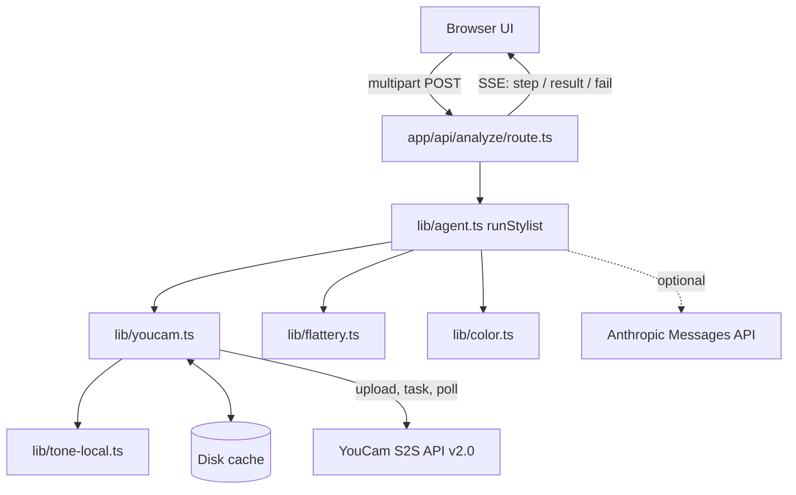
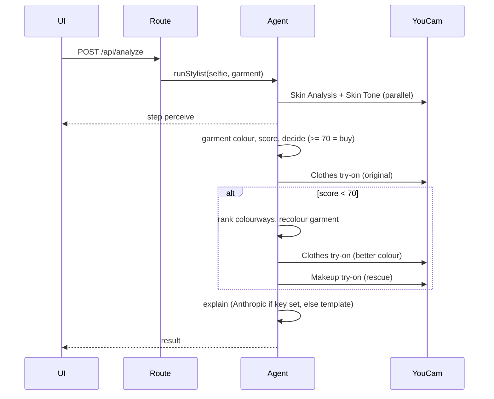

# Architecture

Flattr is a Next.js 15 (App Router, TypeScript) app. A single API route runs a "Stylist Agent" that streams progress to the browser over Server-Sent Events.

## Components

| Module | Responsibility |
|---|---|
| `app/api/analyze/route.ts` | Parses the form, loads images (upload, URL or sample), runs the agent, emits SSE |
| `lib/agent.ts` | Orchestrates steps; each external call is isolated so partial failures degrade gracefully |
| `lib/youcam.ts` | Typed client: File API upload, create task, poll; key selection; cache |
| `lib/flattery.ts` | Deterministic scoring rules, colourway ranking, makeup plan |
| `lib/color.ts` | RGB/LAB/HSL maths, dominant colour (k-means via sharp), garment recolouring |
| `lib/tone-local.ts` | Local skin-tone estimate when Skin Tone Analysis is unavailable |

## Agent sequence

Failures in try-on or makeup steps are recorded in `result.errors` and the rest of the result is still returned. A failure in perceive, garment colour or scoring aborts the run with a `fail` event.

## Skin tone fallback

`skinTone()` calls Skin Tone Analysis when a key (`YOUCAM_KEY_TONE` or `YOUCAM_API_KEY`) exists; on missing key or any error it uses `localSkinTone()` (central face crop, YCbCr skin-pixel gate, per-channel median). The result carries `source: "youcam" | "local"`, shown in the UI as "local estimate" when local.

## Key selection

Per-API override (`YOUCAM_KEY_SKIN`, `_TONE`, `_CLOTHES`, `_MAKEUP`) wins over `YOUCAM_API_KEY`. See [CACHE.md](CACHE.md) for caching and [API.md](API.md) for the HTTP contract.

## Privacy

Images go to YouCam; only a text summary goes to Anthropic if `ANTHROPIC_API_KEY` is set. Nothing is stored server-side except the hash-keyed cache.
